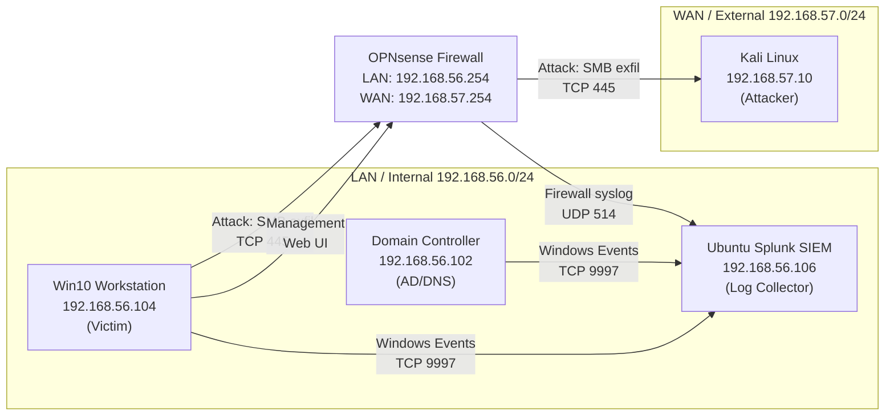

# Data Exfiltration and DLP Detection: Home SOC Lab

I simulated a data exfiltration attack across a segmented home lab, caught it in Splunk from two independent angles, then built a firewall containment rule and debugged it until I could prove it actually stopped the theft.

**Full demo video:** https://youtu.be/Z6pmFaNt-tQ

Everything in this repository was verified against real lab state. Every command, query, IP address, and config line you see here appears in at least one screenshot in the `screenshots/` folder. If I could not confirm something on screen, I left it out.

---

## What You Will Learn

1. How to stage a realistic exfiltration: fake PII collection, archiving, and an SMB copy across a perimeter firewall.
2. How to get two kinds of telemetry into Splunk: OPNsense filter logs over syslog, and Windows Security events through a Universal Forwarder.
3. How to write detection queries that survive small file sizes. The trick: alert on where the traffic goes, not how big it is.
4. How to contain with a surgical firewall rule that kills SMB but leaves management access alone.
5. How to troubleshoot a control that looks right but does nothing. My block rule failed twice, for two completely different reasons, and both fixes are documented here.

---

## Network Topology

The lab is a small fake company network running on VirtualBox. Two segments, one firewall between them.



**The machines:**

| Machine | Role | IP Address | Notes |
|:---|:---|:---|:---|
| Windows 10 | Victim endpoint | 192.168.56.104 (LAN) | Holds the fake PII, runs the Splunk Universal Forwarder, and doubles as my management station for the firewall and Splunk web interfaces. |
| Windows Server | Domain controller | 192.168.56.102 (LAN) | Provides AD and DNS for the `windomain.local` domain. |
| OPNsense | Perimeter firewall | 192.168.56.254 (LAN) / 192.168.57.254 (WAN) | Segments the lab and ships its filter logs to Splunk. OPNsense is a FreeBSD-based firewall distribution; here it plays the role of the company perimeter. |
| Kali Linux | Attacker | 192.168.57.10 (WAN) | Runs an impacket SMB server that receives the stolen file. |
| Splunk Enterprise | SIEM | 192.168.56.106 (LAN) | Receives Windows Event Logs from the forwarder on TCP 9997 and firewall syslog from OPNsense. |

There is also a REMnux VM in the VirtualBox inventory, but it stayed powered off during this project.

**Three traffic flows matter:**

1. **Attack path:** Windows 10 to Kali over TCP 445 (SMB), crossing the firewall from LAN to WAN. This is the exfiltration channel.
2. **Log forwarding:** OPNsense syslog and Windows events into Splunk. This is how the evidence reaches the SIEM.
3. **Management:** the Windows host talking to the firewall and Splunk web interfaces. Stays inside the LAN and must never be blocked, which is why the containment rule targets SMB only.

Full walkthrough with interface details: [`architecture/topology.md`](architecture/topology.md). VM inventory proof: [`screenshots/virtualbox_vm_list.png`](screenshots/).

---

## Tools Used

- **VirtualBox:** hosts the whole lab.
- **OPNsense:** perimeter firewall, log source, and the containment point.
- **Suricata:** the IDS on the firewall, watching SMB sessions with a custom rule.
- **Splunk Enterprise plus Universal Forwarder:** SIEM and endpoint log transport.
- **Windows 10 and Windows Server:** victim endpoint and domain services.
- **Kali Linux with impacket:** the attacker machine and its SMB drop server.

---

## The Short Version of the Story

On the victim I generated 500 rows of fake PII into `PII_Database.csv`, turned on file system auditing with `auditpol`, set an auditing entry (a SACL) on the Documents folder so Windows logs Event ID 4663 every time the file is read, and zipped the CSV into `exfil_package.zip`. On Kali I stood up an authenticated SMB share with impacket. Then I mapped the share from Windows and copied the zip across the firewall.

Three things saw it happen. The Windows Security log recorded powershell.exe reading the archive (Event 4663). The firewall logged the SMB session passing from LAN to WAN. And Suricata raised an alert with my custom signature `SMB Exfiltration LAN to WAN`.

Then came containment: a block rule on the LAN interface denying SMB from the LAN subnet to the attacker segment. It failed. Then it failed again, for a different reason. Section by section, the troubleshooting is the most valuable part of this project, so it gets its own file: [`configs/opnsense/firewall_rules.md`](configs/opnsense/firewall_rules.md).

---

## Repository Layout

```
.
├── architecture/
│   └── topology.md              # Network layout, segments, and traffic flows
├── configs/
│   ├── opnsense/
│   │   └── firewall_rules.md    # Verified firewall rules and troubleshooting
│   ├── splunk/
│   │   └── detection_queries.md # SPL queries with verified results
│   ├── suricata/
│   │   └── custom_rules.md      # IDS alert signature
│   └── windows_victim/
│       └── auditing.md          # Windows audit policy and SACL setup
├── scripts/
│   ├── attacker/
│   │   └── setup_smb_server.sh  # Kali side commands
│   └── victim/
│       ├── make_pii.ps1         # Generate fake sensitive data
│       └── exfiltrate.ps1       # Map share and copy the archive
├── docs/
│   └── incident_response_playbook.md  # Full IR workflow
├── screenshots/
│   └── README.md                # Index of every screenshot and what it proves
└── README.md                    # You are here
```

---

## MITRE ATT&CK Mapping

| Technique | Name | Where It Appears |
|:---|:---|:---|
| T1560.001 | Archive Collected Data: Archive via Utility | `Compress-Archive` verb archiving of the PII CSV into a zip before transfer. See [`configs/windows_victim/auditing.md`](configs/windows_victim/auditing.md). |
| T1048.003 | Exfiltration Over Alternative Protocol: Unencrypted Non-C2 Protocol | The zip leaves over plain SMB on TCP 445 to the attacker server. |

One correction worth knowing for interviews: plain SMB exfiltration is **T1048.003**, not T1041. T1041 is exfiltration over the command and control channel, which only fits when the same channel carries both C2 and theft. Here the SMB copy is a dedicated exfil path, so T1048.003 is the honest mapping.

---

## Key Takeaways

1. **Verify the traffic path before blaming the control.** My rule was correct twice over, and both failures were environmental: first a bypass route around the firewall, then a rule that never got evaluated.
2. **A dual connected machine defeats perimeter controls silently.** One extra VirtualBox NAT adapter gave the workstation a side exit that made every firewall rule irrelevant.
3. **First match wins.** Rule order is not cosmetic. A block rule below a broad allow rule is documentation, not protection.
4. **Trust packet captures and counters over GUI impressions.** The GUI showed a rule that looked right. `tcpdump` and the logs showed what was actually happening.
5. **Prove a fix with a control test.** "It seems to work now" is not evidence. Toggling the rule off and on and watching the outcome change is.

---

## Screenshots Evidence

Every claim in this repo is backed by a screenshot. See [`screenshots/README.md`](screenshots/) for the full index.

| Screenshot | What It Proves |
|:---|:---|
| `virtualbox_vm_list.png` | All five lab VMs are running; REMnux is powered off. |
| `fake_pii_database.png` | PII_Database.csv created at 59,624 bytes. |
| `audit_policy_enabled.png` | File System auditing set to Success and Failure. |
| `sacl_folder_auditing.png` | SACL applied to Documents folder for Everyone. |
| `compress_archive.png` | exfil_package.zip created successfully. |
| `copy_over_smb.png` | File copied from Windows to Kali share. |
| `file_transfer_verified.png` | Zip arrived on Kali; unzip -l confirms PII inside. |
| `firewall_log_pass_evidence.png` | Filter log shows pass, out, TCP 445, 192.168.56.104 to 192.168.57.10. |
| `splunk_4663_security_log.png` | Event 4663 captured in Splunk from win10.windomain.local. |
| `splunk_4663_event_detail.png` | Process Name: powershell.exe, Accesses: ReadData. |
| `splunk_smb_correlation_query.png` | Query 3 result: one session, action pass, first seen 08:52:24. |
| `suricata_alert_and_filterlog.png` | Suricata fired "SMB Exfiltration LAN to WAN" for the same session. |
| `suricata_traffic_detection.png` | Quick hunt for port 445 surfaced 6 matching events. |
| `network_traffic_dashboard.png` | Splunk dashboard showing firewall block and pass entries. |
| `rule_order_problem.png` | Block SMB egress sitting below Default allow LAN. |
| `containment_net_use_fails.png` | System error 67 after containment; net use fails. |
| `tcpdump_silence.png` | Kali tcpdump on eth1 shows zero SMB traffic after block. |
| `teardown_and_retest.png` | ipconfig confirms single adapter, gateway 192.168.56.254. |
| `kali_route_fix.png` | Kali default route fixed to 192.168.57.254 via eth1. |

---

*Built by Ojama Dickson Akpoga. Verified against live lab state on August 27, 2026.*
