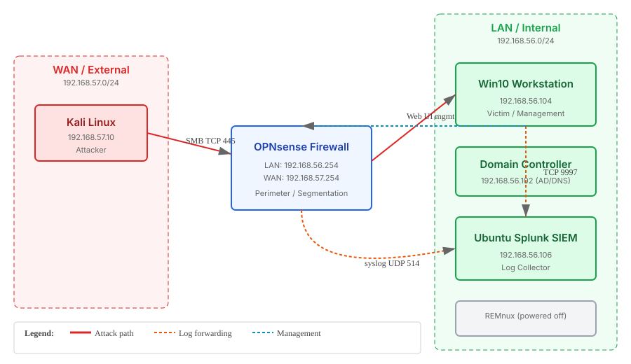

# Simulated Data Exfiltration & DLP Detection

**Live demo:** https://youtu.be/Z6pmFaNt-tQ

This is a home SOC lab project I built to show how I would detect and stop a data exfiltration attack from start to finish. I simulated the entire chain: an attacker compressing sensitive files on a Windows endpoint, copying them out over SMB across a perimeter firewall, and me catching it from two angles in Splunk before building a surgical containment rule that actually worked.

---

## What I Built

A segmented VirtualBox lab with five machines across two subnets, separated by an OPNsense firewall:

| Machine | Role | IP |
|:---|:---|:---|
| Windows 10 | Victim endpoint | 192.168.56.104 |
| Windows Server | Domain controller | 192.168.56.102 |
| OPNsense | Perimeter firewall | 192.168.56.254 (LAN) / 192.168.57.254 (WAN) |
| Kali Linux | Attacker / drop server | 192.168.57.10 |
| Splunk Enterprise | SIEM | 192.168.56.106 |



The Windows 10 box doubles as my management station for the firewall and Splunk web UIs, so any containment rule had to be surgical: block SMB exfiltration without breaking my own access.

Three traffic flows mattered in this lab:

- **Attack path:** Windows 10 to Kali over TCP 445 (SMB), crossing the firewall from LAN to WAN.
- **Log forwarding:** OPNsense syslog and Windows Security events into Splunk.
- **Management:** my Windows host talking to the firewall and Splunk web interfaces, staying inside the LAN.

Full topology details: [`architecture/topology.md`](architecture/topology.md)

---
##Skills Demonstrated 
Detection Engineering & SIEM: Engineered Splunk SPL queries combining endpoint object auditing (Event ID 4663) and OPNsense firewall syslog to detect evasion-prone, low-volume SMB exfiltration crossing internal trust boundaries.

Network Threat Containment: Diagnosed and remediated complex perimeter routing and firewall rule-ordering failures (pfctl, tcpdump), deploying surgical Layer 4 block rules that mitigated active exfiltration while preserving administrative traffic.

IDS/IPS Engineering: Authored and tested custom Suricata inspection signatures targeting suspicious cross-zone SMB sessions, achieving full detection coverage across endpoint, firewall, and IDS telemetry layers.

Host Auditing & Forensics: Configured fine-grained System Access Control Lists (SACLs) and native Windows audit policies (auditpol) to record unauthorized access attempts and script execution handles on sensitive directories.

Adversary Emulation: Simulated real-world adversary behavior using Impacket and PowerShell to stage and compress sensitive mock PII, mapping the operational lifecycle directly to MITRE ATT&CK T1560 and T1048.

## The Attack I Simulated

On the victim I generated 500 rows of fake PII into `PII_Database.csv` using PowerShell, turned on file system auditing with `auditpol`, and set a SACL on the Documents folder so Windows logs Event ID 4663 every time the file is read. I compressed the CSV into `exfil_package.zip` using `Compress-Archive`. On Kali I stood up an authenticated SMB share with impacket's `smbserver`. Then I mapped the share from Windows and copied the zip across the firewall.

Three independent sensors saw it happen:

1. **Windows Security log** recorded `powershell.exe` reading the archive (Event 4663).
2. **OPNsense filter log** logged the SMB session passing from LAN to WAN.
3. **Suricata** fired a custom signature I wrote: `SMB Exfiltration LAN to WAN`.

---

## The Detection Queries I Wrote

I built two independent detections in Splunk SPL:

**Endpoint detection (Event 4663):**
```spl
index=main source="WinEventLog:Security" EventCode=4663
| search Object_Name="*exfil_package.zip*"
| table _time, host, Account_Name, Object_Name
```

This caught 13 events on `win10.windomain.local`, with the expanded detail showing Process Name `powershell.exe` and Accesses `ReadData`.

**Network detection (SMB leaving the internal network):**
```spl
index=main sourcetype=syslog dst_port=445
| where NOT cidrmatch("192.168.56.0/24", dst_ip)
| stats count as packets sum(Data_length) as total_bytes earliest(_time) as first_seen latest(_time) as last_seen values(action) as action by src_ip dst_ip
| convert ctime(first_seen) ctime(last_seen)
| sort - last_seen
```

This returned two packets: `192.168.56.104` to `192.168.57.10`, first seen `08/27/2026 08:52:24`, action `pass`. The `Data_length` was 0, which is exactly why I designed this to alert on destination instead of volume. A compressed file can be tiny and still evade a volume-based rule.

Full queries with line-by-line reasoning: [`configs/splunk/detection_queries.md`](configs/splunk/detection_queries.md)

---

## The Containment Rule and Why It Failed Twice

I built a block rule on the OPNsense LAN interface: deny TCP 445 from LAN net to WAN net. Simple on paper. It failed twice before it worked, and both failures taught me more than the success did.

**Failure 1: a dual-homed workstation bypassed the firewall entirely.**

The Windows victim still had VirtualBox's default NAT adapter attached (`10.0.2.15`), and that adapter held the default gateway. Every packet destined outside the internal subnet, including my simulated exfiltration, left through NAT via the host machine and never touched OPNsense. My firewall rule was correct the whole time. It was guarding a door the traffic never used.

I caught this with an empty `tcpdump` on the OPNsense LAN interface while the file transferred successfully in the background. That single silent capture reframed the whole problem. I detached the NAT adapter, rebooted, and `tracert` finally showed `192.168.56.254` as hop 1.

**Failure 2: rule order killed my block before it was evaluated.**

With the path fixed, the file still went through. I inspected the loaded rules with `pfctl -sr` instead of trusting the GUI. My block rule was there, on the right interface, with the right source, destination, and port. But above it sat:

```
pass in log quick on em1 inet from (em1:network) to any
```

Both rules used `quick`, so first match wins. My exfiltration traffic hit "allow LAN to any" before it ever reached my block rule. I dragged the block rule above the default allow, killed the states, and retested.

**Validation: the control test**

I did not trust a single error message. I verified containment from three angles:

- Victim side: `net use` failed with System error 67.
- Receiver side: `tcpdump` on Kali stayed completely silent. No SYN ever arrived.
- Firewall side: `pfctl -vvsr` showed the block rule counters climbing, and the Live View showed red block entries.

Then I ran a control test: rule on, attack fails. Rule off, attack succeeds. Rule on, attack fails again. That on-off-on sequence proves causation, not correlation.

Full troubleshooting with commands: [`configs/opnsense/firewall_rules.md`](configs/opnsense/firewall_rules.md)

---

## MITRE ATT&CK Mapping

| Technique | Name | Evidence |
|:---|:---|:---|
| T1560.001 | Archive Collected Data: Archive via Utility | `Compress-Archive` of PII CSV into zip before transfer. |
| T1048.003 | Exfiltration Over Alternative Protocol: Unencrypted Non-C2 Protocol | Zip copied out over plain SMB on TCP 445. |

---

## What This Project Shows About How I Work

- I verify before I trust. I checked `auditpol /get` after setting it, confirmed the SACL was applied, and ran control tests on my containment rule.
- I trust packet captures over GUI impressions. An empty `tcpdump` was worth more than an hour of staring at rule settings.
- I think about bypass routes. A dual-homed machine silently defeated my perimeter control until I traced the actual traffic path.
- I write detections that survive evasion. A volume-based rule would have missed my 11 KB zip. Destination-based detection catches the behavior regardless of file size.
- I document causation, not assumption. The on-off-on control test is the strongest evidence that my containment actually caused the stop.

---

## Repository Layout

```
.
├── architecture/
│   ├── topology.md              # Network layout and preflight checks
│   └── topology.svg             # Lab topology diagram
├── configs/
│   ├── opnsense/firewall_rules.md        # Containment rule and troubleshooting
│   ├── splunk/detection_queries.md       # SPL queries with verified results
│   ├── suricata/custom_rules.md          # IDS alert signature
│   └── windows_victim/auditing.md        # Audit policy and SACL setup
├── scripts/
│   ├── attacker/setup_smb_server.sh      # Kali side commands
│   └── victim/
│       ├── make_pii.ps1                  # Generate fake sensitive data
│       └── exfiltrate.ps1                # Map share and copy archive
├── docs/incident_response_playbook.md    # Full IR workflow
└── screenshots/                          # Evidence screenshots
```

---

*Built and verified by Ojama Dickson Akpoga. Lab state confirmed on August 27, 2026.*
